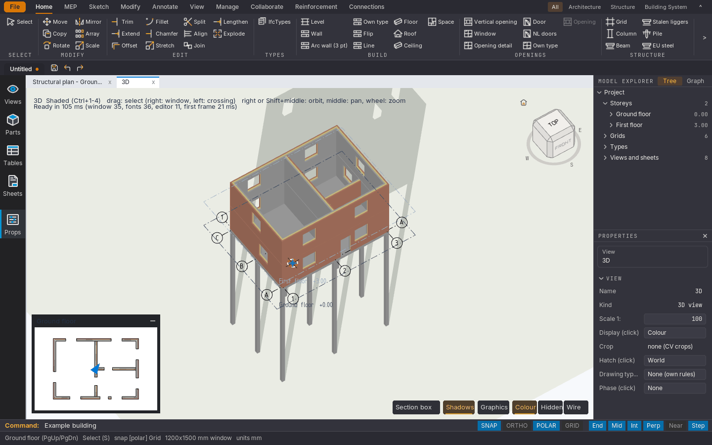
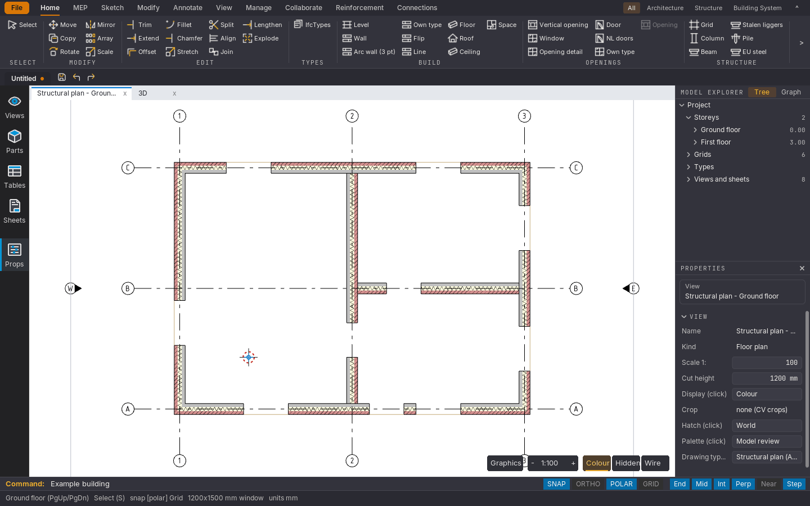
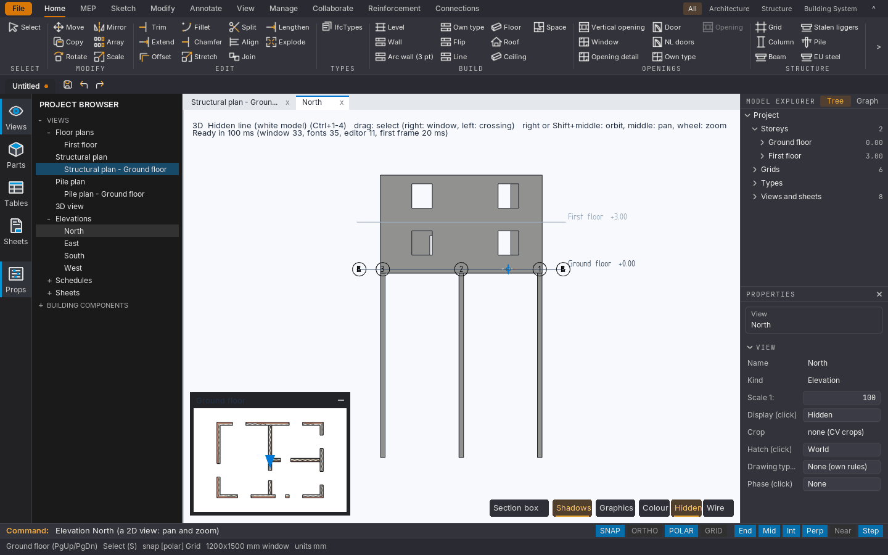
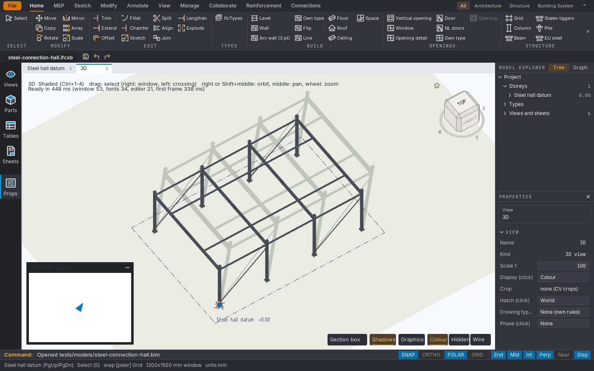
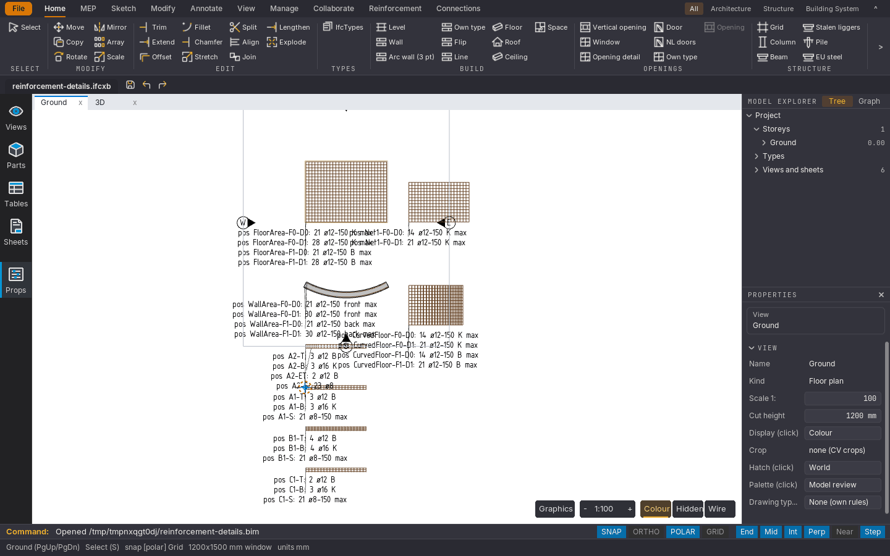
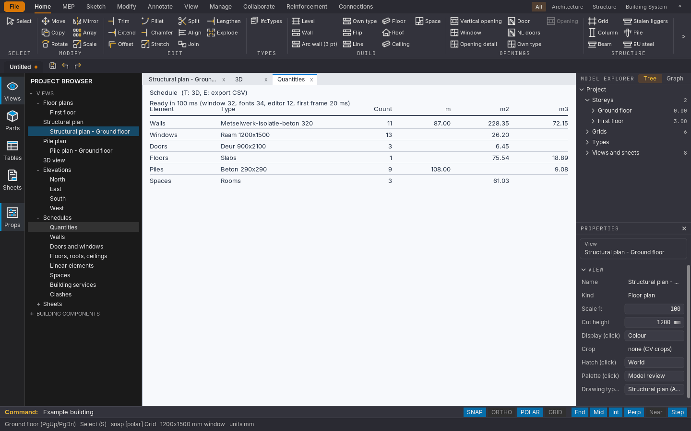

[English](README.md) · **Nederlands**

<div align="center">

# Open BIM Studio

**Native BIM-modellering, parametrische componenten en tekeningen uit het model, gebouwd op een eigen CAD-kernel in DynLex.**

[](https://github.com/OpenAEC-Foundation/open-bim-studio/releases)
[](https://github.com/OpenAEC-Foundation/open-bim-studio/actions/workflows/windows-release.yml)
[](#licentie)

### [Download de preview](https://github.com/OpenAEC-Foundation/open-bim-studio/releases)



</div>

Open BIM Studio is een applicatie van de [OpenAEC Foundation](https://github.com/OpenAEC-Foundation) om bouwmodellen te maken en te bewerken. Je modelleert wanden, vloeren, daken, kolommen, balken, palen, wapening en staalverbindingen, bekijkt ze in 2D en 3D, en maakt plattegronden, gevels, staten en bladen uit hetzelfde model.

Het draait als native desktopapplicatie met een Vulkan/GLFW-interface op Linux; een Windows-port staat in de repository. De applicatie en haar CAD-kernel zijn geschreven in [DynLex](docs/notes/dynlex-guide.md).

> **Ontwikkelpreview.** `main` is de gedeelde ontwikkelbasis, geen productierelease. Functies en bestandsformaten veranderen nog. Dat de compiler een build maakt, betekent niet dat de app, de installer of elke modelleerwerkwijze getest is.

## Probeer het

Installeer de [Linux-preview](#download) en start hem met het voorbeeldgebouw:

```sh
~/.local/bin/open-bim-studio --example
```

Je ziet een gebouw van twee verdiepingen op palen, met stramien, gelaagde wanden, ramen en deuren. Teken een wand vanuit het tabblad **Home**, versleep een grip met **Select**, ga naar het tabblad **3D**, of open links via **Views** een gevel of een hoeveelhedenstaat.

## Download

Elke preview staat op de [releasepagina](https://github.com/OpenAEC-Foundation/open-bim-studio/releases). De nieuwste is [0.1.1](https://github.com/OpenAEC-Foundation/open-bim-studio/releases/tag/v0.1.1).

| Platform | Installer |
|----------|-----------|
| **Linux** (x86-64) | `Open-BIM-Studio-0.1.1-linux-x86_64.run` |
| **Windows** | Nog niet in een release; zie [Windows release](docs/notes/windows-release.md) |
| **macOS** | Niet beschikbaar |

Installeren of bijwerken doe je met `bash Open-BIM-Studio-0.1.1-linux-x86_64.run`. De installer vervangt `~/.local/share/open-bim-studio` en de starter; je projectbestanden staan daar los van. Maak een back-up van je projecten voordat je een preview probeert.

De installer is ondertekend met de OpenPGP-sleutel van OpenAEC (`.asc`, met de publieke sleutel en de vingerafdruk in de release) en staat in `SHA256SUMS`; `VERIFICATION.txt` legt de controle uit. Linux heeft glibc 2.38 of nieuwer nodig, een X11-sessie (of XWayland) en Vulkan.

## Waarom gebruiken?

- **Vrij en open.** Broncode onder MPL-2.0. Geen licentiekosten, geen account, geen lock-in.
- **Open formaten.** Projecten worden als IFCX opgeslagen; IFC gaat erin en eruit.
- **Eén model, alle uitvoer.** Plattegronden, doorsneden, gevels, 3D, staten en bladen komen uit het model en worden er niet naast getekend.
- **Parametrisch waar het telt.** Wand- en bouwsysteemtypes, gehoste ramen, trappen, wapeningskorven en staalverbindingen houden hun parameters en blijven bewerkbaar.
- **Constructieve details in hetzelfde model.** Wapening met posities en buigstaten, en staalverbindingen met platen, bouten en lassen.
- **Aan te sturen door programma's.** Een lokale API en een MCP-adapter laten andere programma's en AI-assistenten de editor bedienen.

## Schermafbeeldingen

| | |
|---|---|
|  **Plattegrond met stramien en gelaagde wanden** |  **Gevel uit het model** |
|  **Staalhal met parametrische verbindingen** |  **Wapening met posities** |
|  **Hoeveelhedenstaat** | |

De schermafbeeldingen tonen de Engelse interface. Ze worden gemaakt door `python3 tools/build_readme_images.py` uit de modellen in deze repository.

## Modelleren

| Onderdeel | Wat er nu is |
|---|---|
| Bouwmodel | Bouwlagen, stramien, gelaagde wanden, vloeren, daken, plafonds, sparingen, balken, kolommen, palen en blijvende ruimten |
| Parametrische systemen | Bouwsysteemtypes met frames en panelen, gehoste raamsystemen, trappen, leuningen en componentbibliotheken |
| Direct bewerken | Selectie, grips, numerieke eigenschappen, snappen, transformaties, contourbewerking met Tab, Push/Pull en vlakken splitsen |
| Wapening | Parametrische staven, korven, beugels, oppervlaktewapening en netten; posities, buigstaten en NL/internationale notatie |
| Verbindingen | Parametrische staalverbindingen, profielinkortingen, platen, bouten, lassen en herbruikbare verbindingstypes |
| Views en tekeningen | Plattegronden, doorsneden, 3D-views, section boxes, maatvoering, labels, tekenstandaarden, bladen en PDF/SVG-uitvoer |

Dit zijn onderdelen die gebouwd zijn, geen bewering dat elke combinatie af of gevalideerd is.

- **Wapening.** Staven worden standaard als hartlijnen met dieptetest getoond, zodat 3D snel blijft; het menu Graphics laat hun diameters zien. Zie [reinforcement scope](docs/notes/reinforcement-scope.md) en de [reinforcement library](docs/notes/reinforcement-library.md).
- **Staalverbindingen.** Recepten voor kopplaten, fin plates, hoeklijnen, stuiken, knoopplaten en voetplaten, en benoemde types die je hergebruikt. Zie de [steel connection guide](docs/notes/connections.md) en de [bewerkbare staalhal](tests/models/steel-connection-hall.bim).

## Uitwisseling

| Formaat | Openen | Opslaan / exporteren |
|--------|------|---------------|
| **IFCX binair** (`.ifcxb`) | Ja | Ja, het projectformaat van de editor |
| **IFCX** (`.ifcx`, JSON) | Ja | Ja |
| **IFC** (`.ifc`) | Ja | Ja |
| **BIM-tekst** (`.bim`) | Ja | Ja, voor fixtures en ontwikkeltools |
| **DXF** (`.dxf`) | Als referentiegeometrie | Ja, R2000: de actieve plattegrond (2D) en het model (3D, met ACIS-solids) |
| **DWG** (`.dwg`) | Als referentielijnen, via LibreDWG als dat geïnstalleerd is | Ja, R2000, native geschreven: dezelfde 2D-plattegrond en hetzelfde 3D-model |
| **PDF / SVG** | Hulpmiddelen voor tekeningimport | Ja, tekeningen en bladen |

Ondersteunde IFC-elementen worden bewerkbare native objecten; andere geïmporteerde geometrie blijft alleen-lezen. DXF ondersteunt nog niet alle entiteiten. De applicatie kan nog niet elke brontekening of elk geïmporteerd object als parametrische geometrie opbouwen; bewaar dus je bronbestanden als je heen-en-terug test. IFC/IFCX-ondersteuning is in ontwikkeling en geen certificering.

## MCP

De editor biedt een lokale automatiserings-API via een map (`--api MAP`, of **Collaborate > Automation > API / MCP**). Daarop draaien een stdio-MCP-adapter en een optionele HTTP-adapter op loopback. Een assistent kan het model lezen, wanden, vloeren, stramienlijnen en bouwsystemen maken, eigenschappen en types aanpassen, lintopdrachten geven, ongedaan maken en opnieuw doen, en schermafbeeldingen maken. Elke modelwijziging is één ongedaan-maakstap in de editor die je voor je hebt, en de API en adapters draaien alleen op je eigen computer. Zie [automation/README.md](automation/README.md).

## Testen en betrouwbaarheid

- **256 headless applicatietests.** Elke test is een DynLex-programma in de map `tests/` van een module, met een vastgelegde verwachte uitvoer (`*.expected.txt`); `build.sh test` compileert, draait en vergelijkt ze.
- **218 kerneltestprogramma's** in `kernel/tests/`. De laatste maatgevende run haalde 173 van de 212 fixtures; de 39 fouten zijn ouder dan de modulesplitsing en staan in [`kernel/tests/KNOWN-FAILURES.md`](kernel/tests/KNOWN-FAILURES.md).
- **43 Python-tests** voor de MCP- en HTTP-adapters in `automation/mcp/test_mcp.py`.

Bron van de getallen: bestanden `*/tests/*.expected.txt` buiten `kernel/`, `*.dl`-bestanden onder `kernel/tests/`, en `def test_` in `test_mcp.py`. Het [consolidatierapport](docs/CONSOLIDATIE.md) legt de geteste basis en bekende fouten vast; het is geen algemene groene buildbadge.

## Huidige beperkingen

- **Geen productierelease.** Bestandsformaten kunnen tussen previews nog veranderen.
- **Windows heeft nog geen geteste installer.** De native port en de ZIP/MSI-pijplijn staan in de repository.
- **De Linux-app heeft X11 nodig.** Hij draait onder XWayland, niet als native Wayland-client.
- **Sparingen in platen hebben nog geen afgeronde werkwijze in de interface.** De geometrie is wel geïntegreerd.
- **Grote modellen zijn traag.** Prestaties bij grote modellen en volledige GUI-regressietests zijn in bewerking.
- **Import is niet volledig parametrisch.** Niet-ondersteunde IFC-elementen blijven alleen-lezen en DXF ondersteunt nog niet alle entiteiten.
- **Volledige builds zijn zwaar.** Een volledige compilatie kan 10 GB RAM benaderen of overschrijden.

Iets gevonden? [Maak een issue](https://github.com/OpenAEC-Foundation/open-bim-studio/issues).

## Onder de motorkap

De applicatie is geschreven in DynLex, een programmeertaal van Engelse zinnen die naar native code compileert. Ze heeft een eigen CAD-kernel (`kernel/`) voor vlakke, NURBS- en B-rep-geometrie, een semantisch BIM-model met transacties en ongedaan maken (`bim/`), en een Vulkan-renderer (`viewer/`). De code is verdeeld in modules in zes lagen, van kernel tot interface; elke module beschrijft zichzelf in een `MODULE`-manifest en `scripts/check-layers.sh` bewaakt de importrichting. Een kleine C-laag (`platform/`) verbindt met het besturingssysteem.

## Bijdragen

- **Probeer het op een echt project** en meld fouten of ontbrekende functies als [issue](https://github.com/OpenAEC-Foundation/open-bim-studio/issues/new). Vermeld de commit of versie van de app, het besturingssysteem, GPU en driver als dat ertoe doet, de stappen om het te reproduceren, wat je verwachtte en wat er gebeurde, en een klein algemeen voorbeeldmodel.
- **Schrijf code.** Lees [CONTRIBUTING.md](CONTRIBUTING.md), de [afspraak voor twee computers](docs/TWEE-COMPUTERS.md) en het [werkbord](docs/WERKBORD.md). Begin een korte taakbranch vanaf `main`, houd productcode in DynLex, lever tests en resterende beperkingen mee in de PR, en stem wijzigingen aan gedeelde model-, editor-, renderer- en bestandsformaatcode af. Compilerwerk hoort in de DynLex-repository.

Houd privé-projecttekeningen, klantmodellen, inloggegevens en lokale toolchainpaden buiten deze openbare repository. Inhoud en commitberichten in de repository zijn Engelstalig.

## Snel beginnen (ontwikkelaars)

```sh
git clone https://github.com/OpenAEC-Foundation/open-bim-studio.git
cd open-bim-studio
export DYNLEX_ROOT="/absolute/path/to/dynlex-cadkernel"   # een gebouwde, passende DynLex-checkout
export BIM_BUILD_DIR="$PWD/build/local-dev"
bash ./build.sh toolchain-info                             # paden en compilerhash; compileert niets
BIM_DEBUG=0 bash ./build.sh dev
bash ./build.sh run-dev --example
```

Vereist:

- Een **checkout van de DynLex-fork** op de vastgezette commit (`codex/cadkernel-port` op `c2d32bea` met de patches uit `patches/`), ter plekke gebouwd in `build/dynlex`. Een willekeurige upstream-compiler wordt niet ondersteund. Zie de [toolchain notes](docs/notes/application-and-toolchain.md).
- Bash, een C-compiler en `ar` voor de native platformbrug; Python 3 voor het bundelen van tests en hulpmiddelen voor tekeningimport.
- Vulkan/GLFW en lettertypen (de installer verwacht Noto Sans).
- Genoeg RAM. Draai **één DynLex-compiler per fysieke computer** en gebruik aparte buildmappen.

Open BIM Studio hoort bij de familie van apps van de [OpenAEC Foundation](https://github.com/OpenAEC-Foundation).

### Bouwen en starten

Open een project door `--example` te vervangen door het pad: `bash ./build.sh run-dev /absolute/path/to/project.ifcxb`. Het ontwikkelprogramma is `$BIM_BUILD_DIR/open-bim-studio-dev`; `bash ./build.sh app` en `bash ./build.sh run --example` bouwen en starten de geoptimaliseerde applicatie.

In plaats van `DYNLEX_ROOT` kun je het pad naar de compilercheckout op één regel in `.dynlex-root.local` zetten (genegeerd door Git; `DYNLEX_ROOT` gaat voor). Noteer zowel de broncommit als de hash van de compiler als je een build meldt.

`build.sh` compileert vanuit de root van de repository: imports zoals `bim/x.dl` worden hier gevonden, `lib/std.dl` in de compilercheckout, en een bestand onder `lib/` hier gaat voor dat van de checkout (zie `lib/README.md`). Elke buildopdracht draait eerst `build.sh generate`, dat het modelrecord en de dispatchers uit de `MODULE`-manifests samenstelt in `generated/` (`tools/compose_modules.py`) en de voorgebouwde shaders naar `build/shaders` kopieert. Het wijzigt de compilercheckout niet.

Op Windows compileert, draait en vergelijkt `scripts/dev-windows.ps1 -Tests evaluate,wall_base` benoemde tests, bouwt `-Kernel` de kernelbibliotheek en draait de seam-tests, en bouwt `-App` de applicatie in `build\windows-app`. Het leest de toolchain uit `.dynlex-windows.local.ps1` (zie `scripts/dev-windows.example.ps1`) en de compiler uit `.dynlex-root.local`.

### Tests

Begin met een kleine headless bundel in plaats van de hele set:

```sh
bash ./build.sh bundle ui_layout text_glyphs plan_pan
```

Gebruik hoogstens **drie tests per bundel**: tests die de volledige editor- of viewlaag importeren, zijn duur, ook zonder venster. Een bundel compileert één keer, draait de controles en vergelijkt ze met de verwachte uitvoer; zoek elke compilermelding of runtimefout uit. Een release vraagt daarnaast een volledige app-build en interactieve en installatiecontroles op het doelplatform.

De README-beelden maak je met `python3 tools/build_readme_images.py` (Xvfb, Mesa's software-Vulkan en Pillow; geen GPU nodig); `--check` controleert ze.

### Indeling van de code

```text
kernel/        CAD-kernel: core/, planar/, nurbs/, space/, brep/, acis/, fast/, tests/, reference/, docs/
bim/           De BIM-kern: document, elementidentiteit, psets, instellingen, index, ongedaan maken
viewer/        Vulkan-laag, shaders, scène, instanties, doorsnedekappen, clashes, canvas
exchange/      ifcx (het native binaire formaat), dxf_dwg, step, import (tekeningen, afbeeldingen, caches)
ifc/           IFC-schema, STEP lezen en schrijven, psets, promote
views/         common, drawings, sheets, schedules, export (SVG, PDF)
materials/     Doorsnedematerialen, arceringen, bibliotheek
localisation/  Landinhoud als data (registry, nl); leeg tot fase 4
automation/    De request/response-API en de MCP- en HTTP-adapters
ui/            editor (het toolraamwerk), properties, panels, shell (main.dl, lettertypen, iconen)
elements/      linear, connection, planar, object: de vormklassen
pattern/       common, grids (Building System)
structural/    rebar, steel, results
architectural/ openings, stairs, spaces
mep/           common (netwerken)
platform/      obs_platform.c, de C-laag per besturingssysteem
generated/     Het modelrecord en de dispatchers, samengesteld uit de MODULE-manifests
tests/         Voorbeeld- en reviewmodellen (tests/models/)
tools/         Modulesamensteller, testbundelaar, probes, iconenmaker, README-beelden, GPU-voorbeeld
installer/     Linux-installer, Windows-pakketscripts en licenties
patches/       Compilerpatches tot ze upstream zijn
lib/           Vervangingen voor de bibliotheek van de compilercheckout (lib/README.md)
scripts/       Het Windows-buildscript en de lagencontrole
build.sh       Lokaal bouwen, starten, testen en installer maken
docs/          Architectuur, besluiten, onderzoek, notities, coördinatie en status
```

`bim/bim_model.dl` bevat de semantische objecten en transacties; `elements/planar/bim_evaluate.dl` leidt de geometrie af; de teken- en scènemodules maken de 2D- en 3D-weergaven. De `bim_editor*.dl`-bestanden in de element-, discipline- en `ui/properties/`-modules voeren bewerkingen uit, en `ui/panels/bim_ui*.dl` en `ui/shell/main.dl` verbinden ze met de interface. `docs/OWNERS.md` noemt de eigenaar per module, de [module guide](docs/notes/module-guide.md) geeft meer achtergrond en het [ontwerp van de modulesplitsing](docs/superpowers/specs/2026-10-28-module-split-design.md) legt de indeling uit.

De repository begon als onderzoeksprogramma. De [visie](docs/vision/vision.md), [architectuur](docs/architecture/overview.md), [ADR's](docs/architecture/decisions/) en het [onderzoek](docs/research/README.md) blijven beschikbaar; oudere plannen kunnen ouder zijn dan de huidige implementatie.

## Licentie

De bronbestanden van de applicatie dragen MPL-2.0-vermeldingen. Afhankelijkheden en meegeleverde bestanden hebben hun eigen voorwaarden; de DynLex-runtime gebruikt LGPL-3.0. Raadpleeg bij het verspreiden van builds de bronvermeldingen van elk onderdeel, de [licentiebundel van de installer](installer/licenses/README.txt), en de vermeldingen bij lettertypen en iconen.

## Handelsmerken

Deze README noemt producten en technieken van anderen, zoals Windows, macOS, Linux en Vulkan. Open BIM Studio is een onafhankelijk project en is niet verbonden aan, goedgekeurd door of gesponsord door hun eigenaars.
