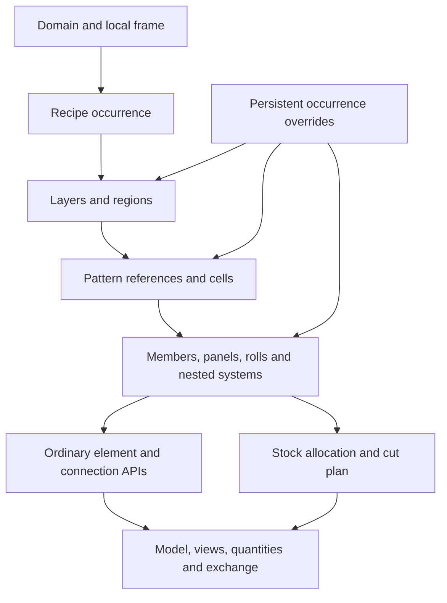

# Building System Generator

**Decision question:** how can one editable, recursive construction grammar generate walls,
ceilings, roofs, floors, frames and finishes, including their manufacture and material use?

**Status:** proposed implementation contract, 29 October 2026. This is a design, not a claim
that the native application already implements every operation. The [delivery matrix](#15-delivery)
distinguishes the existing application, this change and subsequent implementation work.
The [Dutch library](../../localisation/nl/building-systems/README.md) supplies versioned
authoring data and evidence. No structural, fire, acoustic or moisture performance is inferred
from geometry. Accepted ADRs and the module split remain authoritative.

## 1. One system, several independent structures

A building system is a recipe applied to a domain in a local coordinate frame. Its recipe
produces nested regions, reference grids, physical components, connections and fabrication
instructions. A suspended ceiling, running-bond facade, timber wall and window frame use
the same operations with different constraints and component types.

Do not collapse these structures into one array of rectangles:

| Structure | Meaning | Example |
|---|---|---|
| Spatial domain | Where this occurrence can exist | Sloping roof face with rooflight holes |
| Layer stack | Ordered material and service zones through thickness | Membrane, studs, board, service void, gypsum |
| Pattern graph | Reference axes, cells, adjacency and phase | Stagger every second masonry course |
| Assembly tree | Ownership and replaceable subsystems | Prefab panel containing window zone |
| Connection graph | How physical components meet | Cross tee ends at continuous main runner |
| Fabrication graph | Which stock produces which installed parts | One tile supplies two opposite edge pieces |
| Dependency graph | What must be reevaluated after an edit | Window width changes header, boards and membrane |

A reference grid is not a physical member. A member can span several cells. A joint can be
empty space, sealant, mortar, an overlap or a mechanical connection. Replacing a ceiling tile
with a luminaire changes an infill and its interfaces; it does not recreate the grid.

The whole building is a composition of systems hosted on levels, spaces and building faces,
not an enormous tile grid. Adjoining systems share explicit interfaces. Different disciplines
can own adjoining systems without owning one another's element stores.

## 2. Domain, coordinates and classification

### 2.1 Authoring domain

Store `origin`, unit `u`, unit `v`, and `n = u × v` as a right-handed frame, independent of
world axes. Local coordinates are `(u,v,w)`; `w` is depth. Internal length unit is metres;
library records declare millimetres and convert once at the import boundary. Angles have
an explicit unit. A negative layer offset must never silently reverse inside and outside.

A planar domain contains one outer wire and zero or more hole wires, made of lines and
arcs initially. Keep analytic arcs; tessellation is a display operation with a named tolerance.
Reject crossing wires, degenerate edges, holes outside the boundary and ambiguous touching
holes, with an editor highlight. Support disconnected regions as named child domains rather
than pretending a single wire describes them. Sloped planes require no special ceiling code.

Provide two creation paths: sketch a closed contour on a chosen work plane, or choose an
existing wall/roof/floor face. A face host is a semantic reference plus side and extent rule,
not a transient renderer triangle number. Define whether the occurrence follows the host
boundary or preserves its own sketch. Removing the host produces an explicit orphan state
and a repair action; do not move the system to world origin.

Curved wall carriers are a later explicit domain kind, with arc-length `u` and height `v`.
A flat stock sheet may bend only when its material/recipe permits the required curvature.
Double-curved surfaces require a panelisation strategy and distortion limits; a planar tiling
recipe must refuse them instead of projecting an apparently valid fabrication plan.

### 2.2 Semantic role

`hostRole` (wall, floor, roof, ceiling, opening, free-standing) is independent of recipe and
orientation. The same timber framing recipe can be used on several roles, but the selected
application must have compatible support, weather and loading rules. Choosing Roof does
not turn a wall specification into an engineered roof.

Map semantic assemblies and parts through the exchange module: e.g. wall occurrence,
covering/ceiling, slab, roof assembly, window, member, plate and building-element assembly.
Choose IFC class/predefined type from actual function and decomposition; do not export all
parts as curtain wall or confuse this generator with the existing `bim system record`
(building-services distribution group). IFC mapping requires exchange-owner review.
Prefer `BuildingSystemDefinition`/`BuildingSystemOccurrence` in new schema names.

## 3. Definition and occurrence contract

### 3.1 Persistent inputs

| Record | Required contents |
|---|---|
| Definition | Stable namespaced ID, immutable version, labels, provenance, permitted host roles, typed parameters, rules, ports, library dependencies |
| Occurrence | Stable model ID, pinned definition version, parameter values, local frame/domain, host reference, variant, overrides |
| Layer | Stable key, semantic function, thickness/zone, placement reference, enabled state, own pattern, material and coverage rule |
| Region | Stable key, parent, domain expression, priority, ownership of boundaries, fabrication constraints |
| Pattern | Stable key, primitive, phase/origin/rotation, pitches and joint conventions, explicit axes, exclusions, alignment references |
| Part intent | Semantic key, role, component type, local placement, geometry specification, interface ports, material/stock reference |
| Connection intent | Key, participant/port references, meeting plane, continuity priority, connection recipe and parameters |
| Constraint | Key, hard/soft, applicability, units, value/expression, diagnostic and permitted repair |
| Override | Target semantic path, operation, value, scope, inheritance, revision, resolution state |
| Fabrication item | Stock/lot ID, installed part references, cut operations, edge states, residual references and status |

Keep derived geometry, cache and selection handles out of the source of truth. This follows
[parametric components](parametric-components.md). Content instances pin a version; loading a
new library never silently upgrades installed assemblies. Migration previews show added,
removed, changed and orphaned parts/overrides, then commit atomically with undo.

Parameters include length, angle, count, ratio, boolean, enum, material reference, profile
reference, component reference and expression. Distinguish physical thickness, nominal size,
manufacturing size and module pitch. A 600 mm tile module can contain a 597 mm tile and
3 mm joint; neither value may be inferred from a display name.

### 3.2 Semantic identity

Never identify a panel by its current row-major index or a member by triangle order. Keys
compose from definition/layer/region/pattern/axis identities and bounded interval identities.
Explicit axes have stored IDs. Periodic axes use a stable origin and signed ordinal; changing
the pitch preserves ordinal identity but may invalidate dependent edge requirements.

Cells reference bounding axes, course and motif role. Inserting a manual axis splits a cell:
the old cell is retired and its children record lineage. Deleting that axis merges cells and
records both parents. A whole-cell replacement on a split cell becomes an unresolved
override unless its declared propagation is valid; never duplicate one luminaire into two.
Nearest-centroid matching is a user-assisted repair suggestion, not silent identity transfer.

Differentiate part identity from procurement identity: several occurrences may use one stock
piece, and one occurrence may comprise several physical cut parts. Persistent generated IDs
must remain meaningful to dimensions, issues, quantities and exchange after regeneration.

## 4. Layers, regions and recursion

### 4.1 Layer placement and coverage

Choose a datum (e.g. exterior framing face) and define each zone against that datum or an
adjacent layer. Display both thickness and signed face positions. Frame and insulation can
occupy complementary regions in one depth zone; they are not overlapping full-solid layers.
Air cavities can be meaningful zones without an invented solid volume.

Each layer chooses a coverage policy: fill cells, continuous sheet, stock sheet layout,
roll courses, linear repetition, cavity fill, finish coating or nested assembly. Layers can
have different patterns and support constraints. Aligning them is an explicit dependency:
board edge on stud, gypsum seams offset from plywood seams, insulation between studs.

Disabling interior gypsum is a stored occurrence override on the layer key, not deletion of
the library definition. Dependent finishes/fixings are disabled or diagnosed according to
their declared prerequisites. Removing a protective layer invalidates any performance claim
whose evidence depends on that layer. Quantities and export follow the enabled assembly.

### 4.2 Regions around openings

An opening contributes a void, clearance envelopes and required interface zones to every
affected layer. Its effect differs by material: studs reroute around it; insulation stops;
membrane returns and laps; glazing or another system occupies it; finishes get reveal strips.
Rules distinguish rough opening, finished opening, frame outside size and installation gap.

For rectangular board zones, first cut the face into named strips below the sill, above the
head and beside jambs, then place rectangular sheets within those strips. The region strategy
must also permit a board spanning a corner when a tested system requires it. Rectangle-only
is a selectable fabrication policy, not a universal rule for all gypsum or structural sheathing.
Do not force a seam at an opening corner when the chosen system forbids it. Unsupported
board edges trigger blocking/noggins or a different layout. Multi-opening overlaps partition
once by deterministic region priority; no double-counted pieces or forgotten slivers.

An HSB opening subsystem can contain king studs, trimmers, header, sill, cripple studs,
blocking, insulation, tapes, membrane returns, frame and reveal boards. Member sizes and
bearing lengths can be unresolved engineering inputs. A decorative rectangle must not be
reported as a structurally sized header.

### 4.3 Prefabrication partition

Partition a parent into transport/manufacturing units before laying out stock boards when
the recipe requires boards not to bridge a unit boundary. Inputs include maximum length,
height, mass, transport envelope, lifting constraints, admissible seams, opening exclusion
zones and alignment with frame positions. The example 3300 mm limit is a project parameter,
not a Dutch standard. A system of length 7200 mm might use 2400+2400+2400, rather than
3300+3300+600, when the chosen objective values regular units and supported joints.

The partition solver finds admissible cuts, then evaluates span/stock/transport constraints.
Report infeasible when a full-width opening exclusion leaves no permissible cut below the
maximum; do not quietly exceed it. Model duplicated end studs, gaps, connectors and membrane
continuity at each unit boundary. Installed overall length must equal units plus explicit
joint allowances. Unit labels persist while their region identities survive.

### 4.4 Recursive evaluation

Every replaceable cell or region can host a subsystem with its own local frame, definition,
parameters and overrides. Parent-to-child ports carry domain, support lines and constraints;
child-to-parent results carry envelopes, reactions if known, and interface requests. No child
may edit its parent's source records during evaluation. Cap nesting depth and generated part
count. Reject definition recursion (`A → B → A`) and dependency cycles with the actual path.

The same grammar therefore supports a frame with stiles, rails, mullions, transoms, operable
leaves, glazing, beads and seals. A fixed light can be replaced by a compatible sash or door
subsystem. Check handedness, opening sweep, glass support and water path in addition to fit.

## 5. Patterns and members

Initial primitives: parallel courses; rectangular and staggered rectangular lattices; explicit
axes; perimeter offset bands; linear stock courses. Subsequent primitives: herringbone,
basket weave, modular mixed-format motifs, radial and polar grids. Each motif returns cells,
edge roles, adjacency and placement transforms; consumers do not branch on a ceiling/masonry
type number. A motif must declare whether rotation or reflection changes its meaning.

Keep these dimensions independent:

1. Pitch/origin/phase of reference axes.
2. Product manufacturing dimensions and tolerances.
3. Joint centre lines, clear width, depth and material.
4. Profile insertion axis and offsets to actual faces.
5. Cut clearance and installation clearance.

Running bond shifts the motif per course; a half bond shift is half the horizontal pitch.
Course height is brick height plus chosen bed joint, not an unrelated hard-coded number.
Corners need bonded return rules; clipping two independent flat brick grids does not make
a bonded corner. Stacked bond, movement joints, lintels and ties require distinct rules.

User operations: add/remove/move reference axis; change spacing series; suppress its member;
add a member on or off the grid; merge/split cells; lock an axis to a host datum; choose start,
centre, equal-edge or explicit phase alignment. Removing a reference axis and suppressing a
member are different commands with different previews. A physical member can terminate at
an opening even while the abstract axis continues.

Frame members use the ordinary linear-element type, profile placement and edit tools.
Do not introduce a ceiling-only beam class. An infill uses ordinary panel/component types;
a membrane is actual thin geometry/coverage with stock and seam metadata, not just a colour.
Rendering may simplify small components by view detail without deleting their identities.

## 6. Connections and boundaries

At a crossing, negotiate continuity and termination by declared role: main runner continuous,
cross tee terminated; stud to plate; mullion to transom; stile/rail tenon; edge to wall angle.
Geometric overlap removal is not a mechanical connection. Reference-axis intersections,
fabrication end planes, copes, bearings, mitres, fasteners and installation gaps are separate
outputs. Splices along a continuous member also depend on stock length and connector rules.

The generator submits a connection intent to `elements/connection`, which resolves ordinary
connection objects using its own supported operations. Required API proposal:
`resolve(part-port references, connection-definition reference, parameters, model revision)`
returns connection ID, participant modifications, accessories and diagnostics. This is a
proposed contract to agree with the owner, not an existing pattern signature.

Boundary roles: exterior perimeter, hole perimeter, adjacent subsystem, construction joint,
movement joint, free edge, support and closure. Each can select a perimeter profile, end cap,
flashing, seal, lap or clearance. Corners specify mitre/butt/continuous/curved return. Every
boundary has one owner; neighbouring systems may supply complementary interfaces without
both generating the same trim or seal.

Suspended-ceiling hangers are point components supported by the structure above. Fixture
loads, service penetrations and removed runners can invalidate the support solution. A
600×600 face envelope alone does not make every light fixture compatible. Ports describe
support, required clearance, finish edge, services and installation/removal access.

## 7. Overrides and editing behaviour

Precedence: immutable definition defaults → selected variant → occurrence parameters →
layer/region overrides → explicit part replacement/suppression/placement. A newer user edit
only supersedes the same property at the same scope; rule order is never precedence.
Derived safety/compatibility checks run after overrides and remain visible.

| Command | Persistent effect | Regeneration |
|---|---|---|
| Change type/parameter | Set occurrence value | Regenerate affected dependency subgraph |
| Disable layer | Suppress semantic layer subtree | Recalculate interfaces, quantities and evidence applicability |
| Replace tile with light | Component reference on stable cell | Preserve cell/grid; validate ports and support |
| Suppress generated member | Tombstone on semantic part key | Grid survives; dependent support checks run |
| Add manual member/grid | New authored ID and placement/constraint | Survives unrelated pitch changes |
| Adjust generated part | Local parameter/placement override | Check resulting gaps and neighbour compatibility |
| Unpin/detach | Ordinary element plus source tombstone/lineage | Parent does not duplicate it; detached part remains editable |
| Repin | Explicit reconcile preview | Remove detached copy only on successful replacement |
| Reset override | Remove selected override record | Inherit next applicable value |

Changing a system type must show incompatible overrides before committing. Store orphaned
overrides with their original target and reason; expose repair, retarget, discard and keep
detached options. Repeated regeneration is idempotent. Selection, annotations and quantities
must not jump to a different part when a preceding cell is deleted.

Every edit, including nested regeneration, connection changes, stock allocations and
detached-part creation, is one undoable model transaction. Cancelled preview changes nothing.
Undo restores both input state and semantic identities; regenerating after redo produces the
same result. Do not persist renderer handles in the undo model.

## 8. Material yield and cutting

### 8.1 Geometry and stock are different

First generate installed requirements, then allocate those requirements to stock. Clipping
a tile polygon determines the installed shape, not the number of new tiles needed. Each stock
record includes product, dimensions, thickness, material/finish, batch/calibre/shade,
direction/grain, allowed rotations, permitted mirroring, edge states, cutting process, kerf,
minimum reusable size and stock quantity. A purchased box or roll is a procurement unit.

Each installed edge has a requirement: factory edge, field cut allowed, tongue, groove,
bevel, sealed cut, hidden perimeter or visible finished edge. Cutting transforms edge states;
turning a tile rotates its factory edges and face direction. Reflecting a two-dimensional
outline is not permission to flip the decorative face. A damaged or incompatible remnant
cannot be reused just because its bounding box fits.

Residuals have a unique ID, source stock, actual remaining geometry, intact edges, grain,
batch, location, availability time and disposition. Allocate a residual at most once. Reuse
across rooms or projects is opt-in with compatible lot, quality and availability constraints.
Keep ledger states reserved, cut, installed, reusable inventory, recycled and waste distinct.
Uncut stock can be returned; reusable inventory is not automatically counted as diversion
or an avoided purchase until an actual allocation occurs.

### 8.2 Solving and objectives

Two coupled problems: choose an attractive/installable layout (phase, orientation, borders,
seam positions) and choose a feasible stock cutting plan. Respect hard rules before cost.
Rank feasible plans lexicographically: hard constraints; required edge/visual alignment;
minimum border and part sizes; purchase cost/new stock; discarded mass/area; cut/setup effort.
Let the user choose and save another objective ordering. Show trade-offs rather than silently
shifting a centred tile layout to save one tile. Locked layouts remain fixed while cutting is
optimised. Use deterministic tie-breaking and store algorithm version and input hash.

Start with one-dimensional cutting for profiles and roll lengths, then rectangular guillotine
sheet nesting with allowed rotations. Curved tile pieces need polygon nesting and cutting
capability; until supported, label stock use conservative and do not claim optimal yield.
Bound search by time/candidate count. Return best feasible plan plus lower bound when known,
not an unproved global optimum. No feasible plan is a distinct result from search timeout.

Example fixture (authoring values, not a product recommendation): a 597×597 mm tile cut with
3 mm kerf into a 250×597 edge strip leaves a 344×597 residual. A later 340×597 strip can be
cut from that residual with 3 mm kerf, leaving 1×597 scrap. This reuse is legal only when
direction and required factory edges permit it. Totals: installed 590×597, kerf 6×597 and
scrap 1×597 = purchased 597×597. If the second strip needs the lost factory edge, buy another
tile and retain or discard the residual explicitly.

### 8.3 Curved borders and reconciliation

For a floor with a rounded boundary, create a true offset border band and inner field domain.
Specify border width measured normal to the boundary, corner transitions and minimum radius.
Offsets can self-intersect or eliminate the inner field; diagnose this before tiling. Borders
can be cut from full tiles, use separate border products, or comprise segmented pieces with
explicit joint fan geometry. Curved edges do not imply bendable tiles. Holes and columns get
their own perimeter treatment. Preserve movement joints across field and border layouts.

Use one consistent quantity basis: for sheet/tile stock, gross purchased area equals installed
area + kerf + scrap + remaining reusable inventory + uncut balance, within tolerance. Include
incoming/outgoing reused stock as transfers when reporting multiple systems; never count the
same residual as waste and reused material. Report overlaps separately for rolls: net covered
area, installed material area including laps, purchased material, remnants and discarded area.
Profiles use lengths/volumes; consumables can use independently stated factors. Keep box
rounding, breakage allowance and geometric cutting loss as separate quantities.

## 9. Evaluation, diagnostics and scale

Evaluation is a pure proposal from an immutable model revision, followed by a validated atomic
commit. Sequence: validate inputs → resolve hosts/parameters → layer zones → prefab regions
→ opening regions → patterns → part intents → interface/connection resolution → stock plan
→ quantities/evidence applicability → model diff. Dependencies may require another local pass
(e.g. blocking added by board-support rules); use declared stages and convergence limits,
not unbounded rules that mutate each other until they happen to stop.

Invalidations are scoped: changing a panel finish should not regenerate all studs; moving a
window affects intersecting framing, boards, membranes and connections; changing a shared
level affects hosted placements. Cache by input hash, recipe/solver/kernel versions and
tolerance policy. A preview from an old revision is discarded. Only complete valid diffs
become committed model state; retain last valid geometry with a stale/error badge on failure.

Diagnostics include rule key, severity, affected semantic entities and view highlights.
Distinguish invalid domain, infeasible constraints, missing product, unsupported operation,
orphan override, unresolved engineering, solver budget and internal error. An override cannot
silence a physical incompatibility by merely hiding its diagnostic; accepted exceptions are
stored separately with author, reason and scope.

Performance acceptance must be measured on named hardware and model fixtures. Preview may
use procedural batches/instances, then materialise individual ordinary elements on selection
or commit. Stable semantic IDs remain available independent of display detail. Define and
expose generation limits; ask before generating millions of bricks, not after freezing the UI.
Large buildings are scheduled as incremental systems, not one compiler-generated mega-list.

## 10. Modelling interface

The normal path is direct modelling, consistent with the component-authoring proposal:

1. Choose Building System; sketch contour or select host face; show local axes and side.
2. Choose a library recipe/variant. Preview a representative section and required inputs.
3. Set datum, dimensions, orientation, phase, enabled layers and opening/edge rules.
4. Preview the complete system; toggle layers, grid, components, connections and prefab units.
5. Select a semantic component. Breadcrumb: system → unit → layer → region → cell → part.
6. Replace, suppress, add, detach, or reset using the ordinary element tools. Show inherited
   values and their source; a pin icon distinguishes generated, overridden and detached states.
7. Open Material Plan for stock allocations, remnants, cut labels and alternative layouts.
8. Commit as one transaction; inspect plan/section/3D and quantities from the same model.

The property panel has Layout, Layers, Parts, Boundaries, Fabrication and Evidence groups,
with only applicable controls shown. Selecting a reference axis exposes spacing/alignment;
selecting its member exposes profile/connection. A visible command names the consequence
("remove grid and merge cells" or "remove profile only"). Layer removal previews dependent
objects. Curve tools operate on the authoring contour, not the mesh.

Show centred/start/end alignment alternatives with border dimensions and material differences.
Use colour overlays for factory edges, cuts, reused pieces and waste, plus labels/patterns for
accessibility. A cut list is traceable in both directions between stock and installed part.
Definition authoring adds rules to a modelled example; a rule graph is an advanced view rather
than a prerequisite to place a ceiling. Show unresolved inputs before Generate.

## 11. Worked reference assemblies

### A. Suspended ceiling with a luminaire

Contour and columns define the ceiling domain. A 600 mm square motif supplies cells; a separate
support layout supplies continuous main runners, cross tees, wall angles and hangers. Set
border alignment and minimum cut width. Replace one infill with a compatible light subsystem;
preserve cell ID, verify access/envelope/support and request any additional hanger. Removing
a cross tee creates a support diagnostic unless an alternative approved detail resolves it.
Change the contour and preserve the replacement if its cell still exists; otherwise expose
an orphan. Rectangular 1200×600 layouts reuse the same rules with a different motif/support map.

### B. Prefabricated HSB wall with a window

Layer functions from outside to inside can include water-resisting breather membrane, frame
and insulation, sheathing, vapour/air control, service battens/insulation and gypsum. Actual
order and membrane properties are recipe-specific; do not assume the same order for every
wall. Rolls have course width, overlap direction, sealed joints and opening returns. Framing
centres (e.g. chosen 600 or 610 mm) must be coordinated with actual board widths, edge gaps
and support conditions, not treated as equivalent grids.

Place a window subsystem in a rough opening; generate opening framing and board regions.
Partition the wall under the chosen prefab maximum and forbidden seam zones. Split rolls or
provide installation laps across prefab joints as specified. Disable interior gypsum on one
occurrence; dependent finishes and evidence update. Replace the window leaf configuration
without regenerating unrelated wall units. Produce unit assembly drawings, stock cuts and
opening schedules referencing the same semantic parts.

### C. Masonry facade

Choose actual brick size and mortar joint; select half bond, stack or another motif and
starting course. Resolve corners, jamb returns, sills, lintels, ties and movement joints as
separate subsystems/interfaces. Do not turn every mortar grid line into a beam. Track full,
half and cut units and batch. A change to an opening updates adjacent courses and accessories;
it does not reassign a manually chosen accent brick to an unrelated location.

### D. Timber window

An outer contour bounds a frame subsystem. Explicit axes define mullion/transom positions;
cells hold glazing, sash or door subsystems. Frame profiles are ordinary linear elements with
role-specific orientation, weather seals, glazing support, corner and end connections. Frame
depth alone does not define rebate, drainage, sill slope or installation detail. Use named
head/jamb/sill interfaces and preserve interior/exterior handedness when mirrored. Product
and KVT evidence applies to a specified assembly and exposure, not every rectangular frame.

### E. Tiled floor with a curved perimeter

Sketch line/arc contour and movement-joint zones. Choose actual tile calibre/direction and
module joint. Create optional border band; compare centred vs aligned field phases. Generate
cut shapes and edge requirements; allocate reusable opposite-side remnants where feasible.
Report purchases in whole boxes separately from net installed area. Lock a chosen phase,
regenerate after a boundary change and show changed cuts/reservations before commit.

### F. Hollow-core floor

A span-direction system repeats planks, supports and grout joints with supplier-specific
nominal/working widths. Edge infills are restricted products/cuts, not arbitrary narrow
rectangles. Openings consider strands, webs, bearings and trimming interfaces. Require
supplier/engineer approval inputs for structural cuts. Reuse the pattern/stock/connection
framework without treating prestressed units as ordinary cuttable tiles.

## 12. Library policy

Separate generic conceptual assembly recipes, verified product facts, and tested/declared
complete-system performance. Each source has retrieval date, applicability, document version
when known and exact parameter scope. Unknown thermal/fire/acoustic/structural values remain
unknown. Do not invent a supplier endorsement or copy proprietary drawings into the repo.
Dutch labels belong in localisation data; engine keys and code remain English.

Library families cover HSB exterior/interior/service walls; timber/metal frame partitions;
visible/concealed suspended ceilings; fixed/single/double/sidelight/transom windows and doors;
brick and sand-lime patterns; tiled floors/walls with straight/curved borders; facade sheet,
timber and standing-seam cladding; timber floor/roof panels; hollow-core and other prefab
systems. Each family names boundaries, openings, substitutions, stock and unresolved inputs.
Variants share base definitions; they do not duplicate an entire solver for every thickness.

## 13. Module ownership and migration

`pattern/common` owns generic rule/planning contracts, semantic overrides and catalogue
interfaces. `pattern/grids` owns pattern generation. `pattern/facade` initially adapts the
existing occurrence store; naming can evolve without breaking persisted models. Generic
elements own physical part types, `elements/connection` owns connection resolution, kernel
owns robust geometry, exchange owns IFC, localisation owns Dutch labels/content, materials
owns material identity and evidence. UI consumes public module commands; no pattern import
may acquire an additional UI or discipline dependency.

Existing implementation audit at main `c5fdfc8`:

| Existing source | Supported baseline | Limitation for this proposal |
|---|---|---|
| `pattern/facade/records.dl` | Upright/curved curtain-style record; separate service-system groups | Not yet the generic domain/definition schema |
| `pattern/common/bim_system_types.dl` | 43 append-only recipes and HSB layer recipes | Integer recipe identity, content/code mixed, no stock/constraint schema |
| `architectural/stairs/bim_stair.dl` | Layers, nested panel systems, contour panels, profiles, pin/unpin | Generic generation resides in a discipline file; index-based part settings |
| `pattern/grids/bim_grid_pattern.dl` | Explicit spacing patterns with bounded input | Reference grids are not yet a complete cell/connection graph |
| `viewer/bim_scene.dl` and facade scene hook | Visible meshes and part selection | Generation/render separation still incomplete |

Keep legacy recipe indices stable. Add a namespaced definition-ID mapping and store a version
alongside new occurrences. Old files retain old semantics unless migrated explicitly. First
extract/adapt existing generation behind public pattern APIs; do not rewrite all modules in
one change. Coordinate viewer and stairs edits with their owners; this proposal does not
grant ownership of those shared files. Check persistence, copied IDs and undo before expanding
the live library. Existing records/settings must not be reinterpreted by reordering arrays.

## 14. Acceptance fixtures

Tests exercise domain outcomes, not only helper arithmetic. Use exact semantic assertions and
tolerances with named units. Pair module tests with native editor/API transaction checks.

| Fixture | Required observable result |
|---|---|
| Ceiling 4.8×3.6 m plus LED cell | Stable replacement after unrelated edit; support diagnostics on incompatible substitution |
| Ceiling L contour and columns | No panel outside domain or overlapping holes; perimeter parts counted once |
| HSB 7.2×2.8 m, window and 3300 max | All units below maximum; no forbidden seam; rectangular-board policy and support verified |
| HSB with interior layer disabled | Parent/children, quantities, evidence, undo and save/reload agree |
| Opening moved across prefab seam | Deterministic re-partition or explicit infeasible result; no stale framing |
| Timber frame with inserted mullion | Explicit ID preserved; former cell replacement becomes visible orphan when split |
| Two brick courses and a corner | Correct bond phase/joints; no duplicated corner brick/mortar |
| Tile 597 mm, two opposite edge strips | Kerf/edge-aware reuse, single allocation and complete balance |
| Directional tile / factory-edge mismatch | Reject geometrically fitting residual; reason shown |
| Rounded tile border, radius below width | Offset collapse diagnosed; no invalid inner loop |
| Slope/rotation/mirrored placement | Local geometry and outward side correct, no face/grain reversal |
| Save/reload, undo/redo, definition upgrade | Same stable IDs; explicit migrations and orphan records |
| Duplicate evaluation / cancelled preview | No duplicate parts/residuals; model unchanged on cancel |
| Cycle, zero pitch, excessive part count | Bounded refusal with rule path; no partial commit |
| Multi-room remnant ledger | No double use; incoming/outgoing transfer reconciled |

## 15. Delivery

1. **This change:** design, evidence-based authoring catalogue, validation and native planning
   primitives with focused fixtures. The catalogue now covers 183 presets in 43 families and
   83 substitution interfaces, with a bounded native metadata reader and capability checks.
   Catalogue records are not yet connected to live model placement.
2. **Identity and migration:** public pattern API, versioned definitions, semantic part keys,
   persistent overrides and compatibility adapter; save/reload and undo fixtures first.
3. **First complete vertical slice:** suspended ceiling with contour, independent grid/member
   edits, LED substitution and ordinary connection intents, end-to-end native UI/API tests.
4. **Layered fabrication slice:** HSB units, opening framing, rectangular board regions,
   roll laps, per-layer override and unit drawings.
5. **Yield slice:** tile field/borders, edge-aware residual ledger, cutting optimiser and
   stock-to-model highlighting; profile/roll stock allocation.
6. **Family expansion:** detailed window/masonry/floor/roof/cladding adapters, validated product
   packs and evidence-scoped performance checks. Import catalogue records only as capabilities
   become available; show capability requirements rather than silently dropping rules.

Each slice needs a reviewable PR and agreed module interfaces. The verdict is to build one
construction grammar with independent domain, pattern, assembly, connection and stock graphs.
Existing curtain-style generation is a migration starting point. It does not yet satisfy the
generic editing and fabrication contract above.
