# Screenshots

Screenshots of the Open BIM Studio dev build (11 November 2026), 1440 x 900, taken on a headless display with a software renderer.

## Example house: structural plan with grids and dimensions

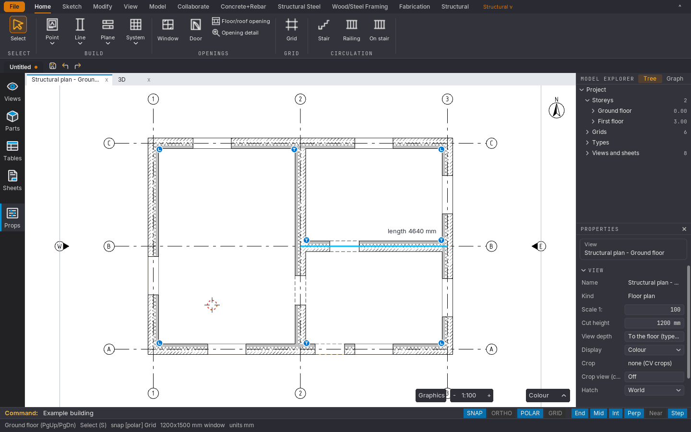

## Example house in the 3D view, with the view cube and the plan inset

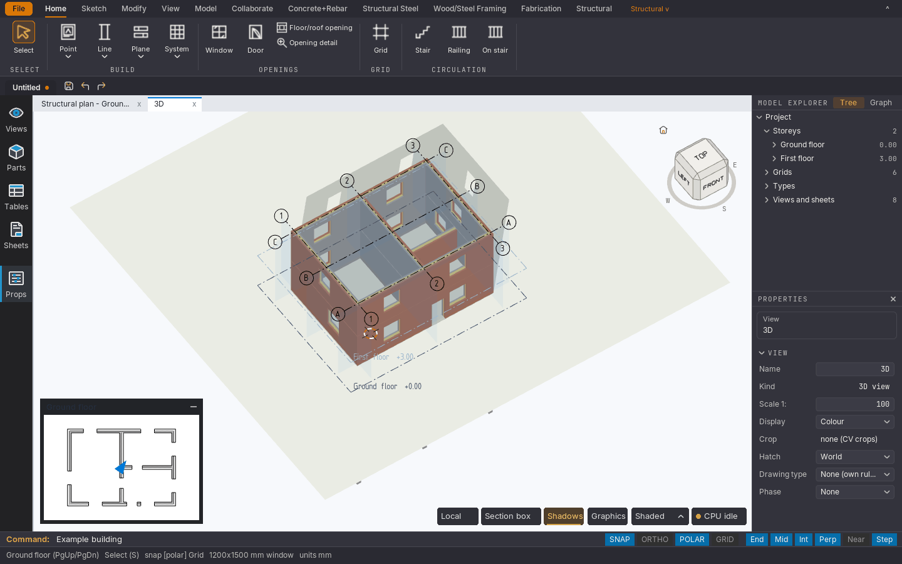

## Demo pavilion: ground floor plan with reinforcement tags

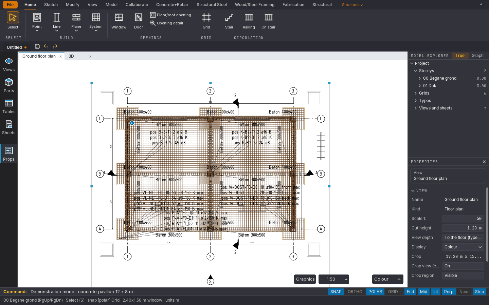

## Demo pavilion in 3D beside the project browser

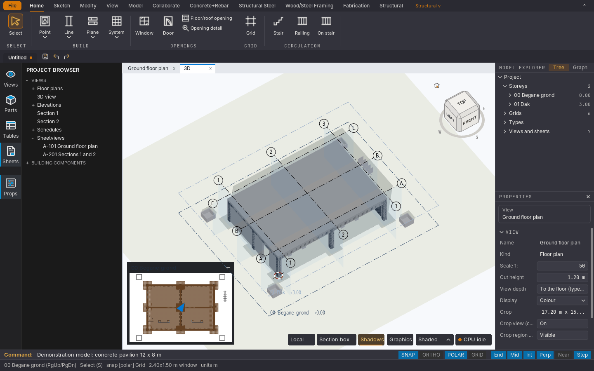

## Demo pavilion: section view

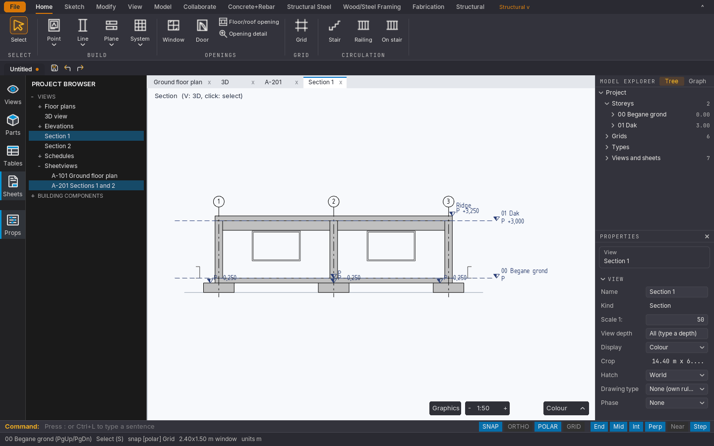

## Demo pavilion: sheet A-201 with two sections

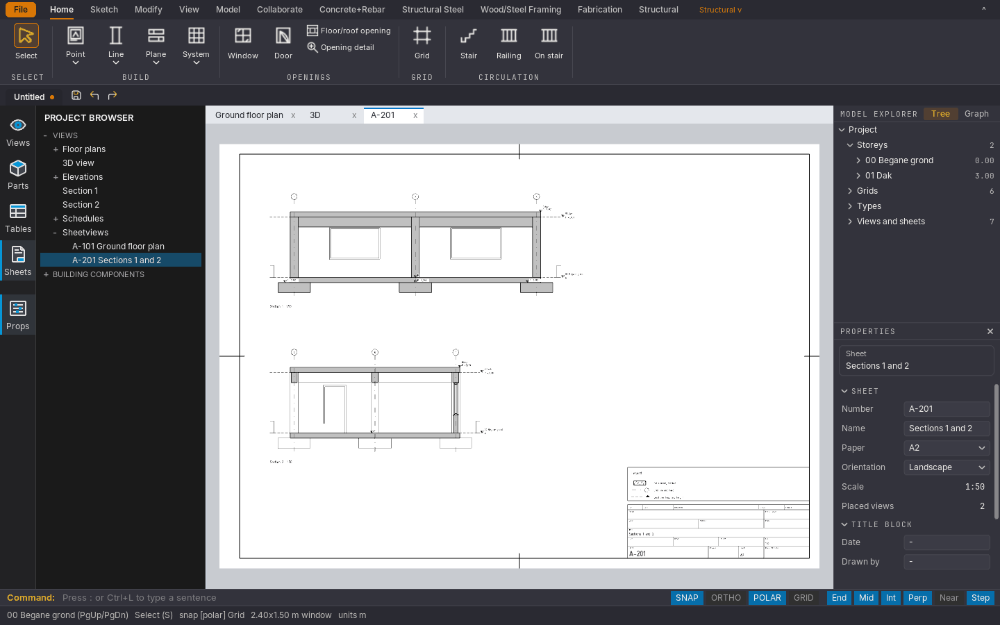

## Two-storey braced steel frame: plan with the project browser listing views, details and sheets

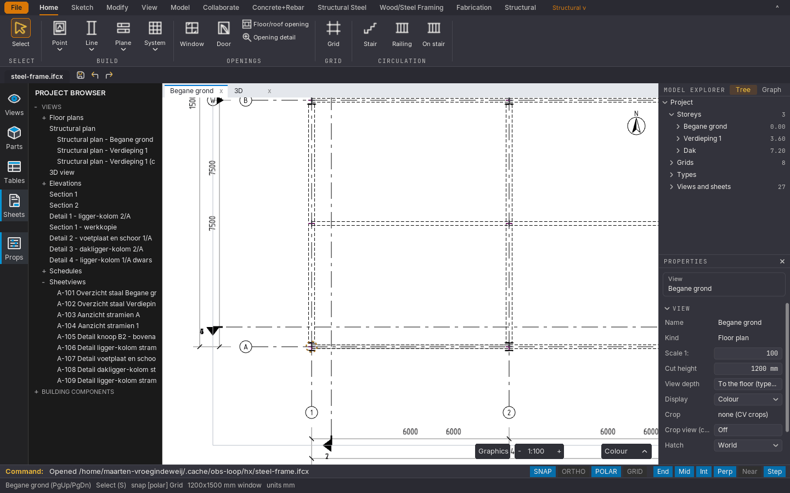

## Braced steel frame in 3D with grids and levels

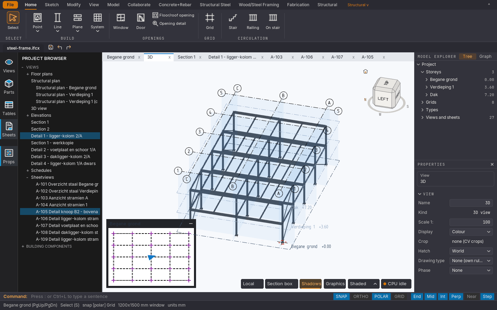

## Steel frame: elevation with height marks on an A2 sheet

## Connection detail 1:10 on an A3 sheet: base plate with anchors and a brace

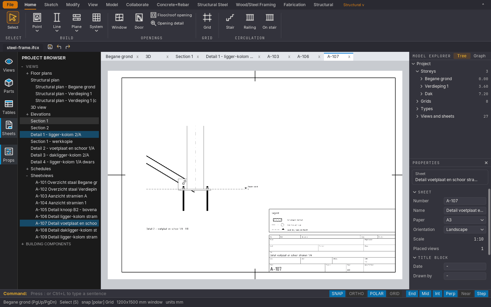

## Connection detail 1:10 on an A3 sheet: beam-to-column node seen from above

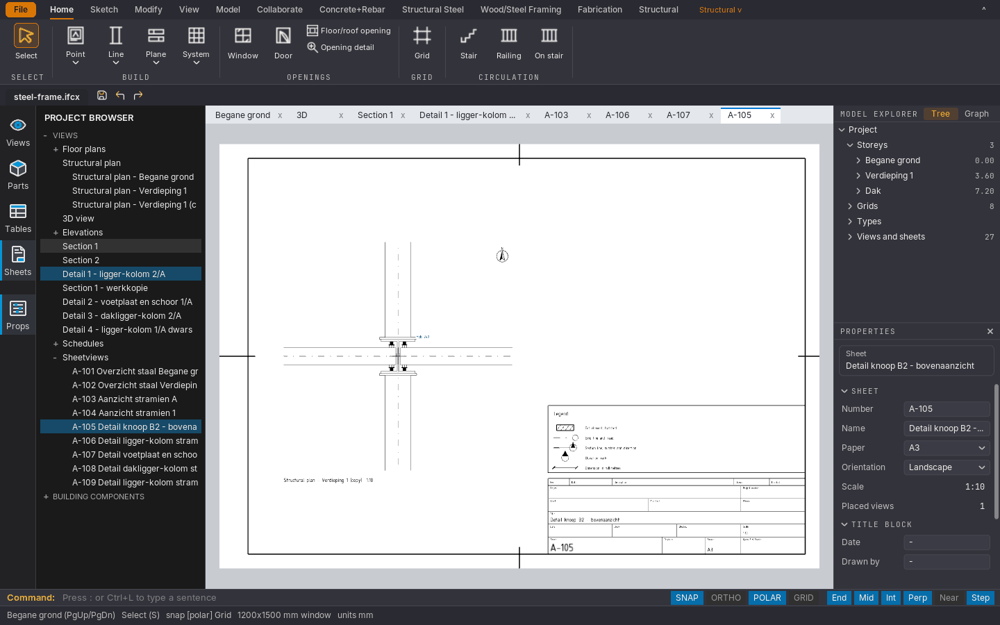

## Steel hall in 3D with the Structural Steel ribbon tab (connection recipes, welds)

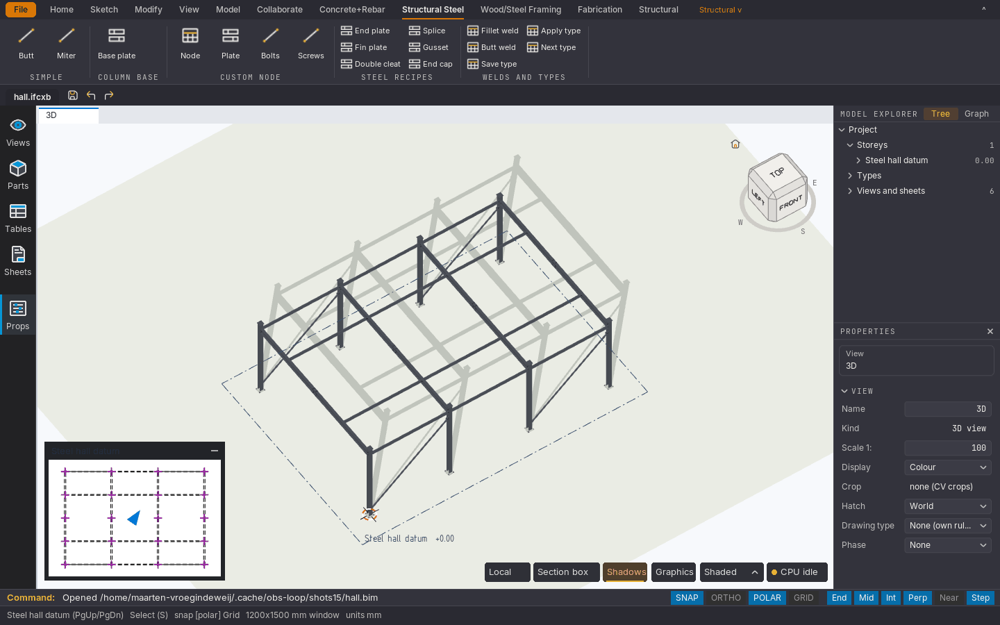

## House floor plan with rooms, dimensions and the schedules in the project browser

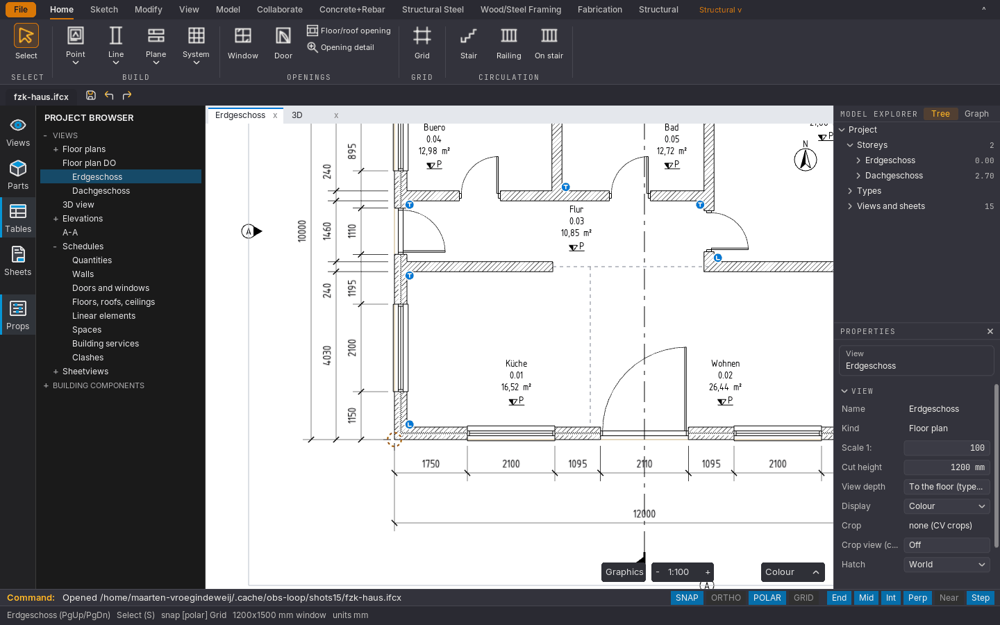

## The same house in 3D

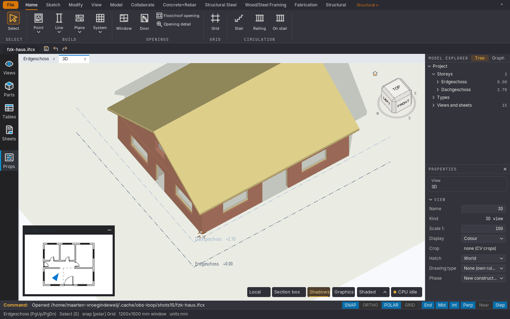

## Generated large model: 20 400 walls and 800 openings on four storeys, in 3D

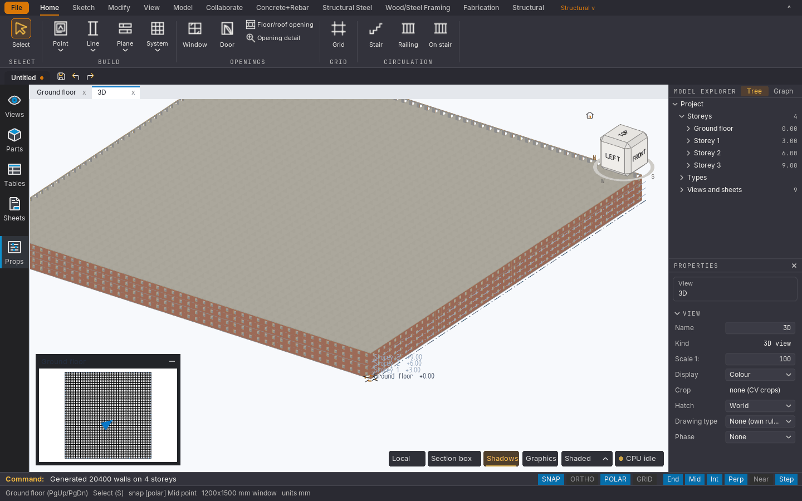
